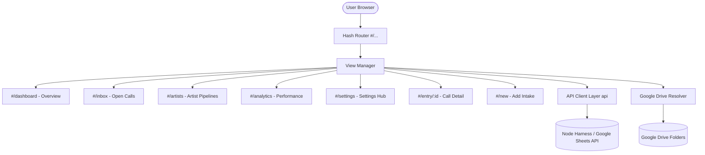

> **OUT OF DATE (noted 11 Nov 2026).** This file describes the backend as a Node harness. The real backend is Google Apps Script bound to a Google Sheet; the Node harness is only the local test server. The Drive map in section 5 no longer exists. See `README.md` for the current picture.

# Tikorix Architecture Specification

## 1. Overview & Philosophy

Tikorix is structured as a resilient, zero-build static single-page application (SPA). It communicates with a backend service (Google Sheets / Cairn backend via local Node harness) over clean JSON API endpoints.



---

## 2. File Organization

```
New folder (2)/
├── index.html            # Core HTML markup, view templates, modals & SVG icons
├── styles.css            # Design system, CSS variables, dark/light themes, layouts
├── app.js                # Application state, hash router, API calls, event handlers
├── UI_UX_SPEC.md         # Comprehensive UI/UX Design System Specification
├── run-axe-audit.py      # Automated Axe Core accessibility verification script
├── README.md             # Project overview, feature guide, and running instructions
├── ARCHITECTURE.md       # Technical design, data flow, and interface contracts
└── map.md                # Cairn service and contract synchronization map
```

---

## 3. Data Flow & Routing

### 3.1 Hash Navigation (`onRoute`)
Routes are managed by listening to `window.addEventListener('hashchange', onRoute)`.
- `#/dashboard`: Aggregated focus queue, KPI statistics, and alerts.
- `#/inbox`: Full catalog of open calls, filter pills, search input, multi-select bulk actions, and viewable half-pane.
- `#/artists`: Roster navigation, secondary artist context bar, stage tables, and Drive dossier links.
- `#/analytics`: Conversion rates, submission volume, and institutional impact metrics.
- `#/settings`: Administrative settings hub containing cards for Form Fields, Reminders, Reports, and Team & People.
- `#/new`: Intake ingestion card (link scraping / file drop) and manual detail submission form.
- `#/entry/:id`: Comprehensive call breakdown, fee analysis, artist assignment, and approval workflow.

### 3.2 State Management & Global Scope Exposure
Because `app.js` runs as a strictly scoped IIFE to avoid polluting the global window object, functions called directly by inline HTML event attributes (`onclick`, `onchange`) are explicitly bound to `window`:
- `window.openProfileMenu`: Dedicated user profile, appearance switch & sign-out sheet
- `window.openAssignProfileModal`: 3-dots opportunity assignment to artist profile
- `window.showWhoAreYou`: Team & people manager
- `window.openAlerts`: Notifications sheet trigger
- `window.openArtistDrive`: Google Drive folder router
- `window.toggleSelect`: Table row multi-select handler
- `window.toggleSelectAll`: Table header select-all handler
- `window.openReports`: Reporting modal
- `window.openReminders`: Automated reminder configuration
- `window.openCallHalfPane` / `window.closeHalfPane`: Split-container half-pane preview

---

## 4. Theming System

The app utilizes CSS custom properties with dedicated support for `device` (OS media query `prefers-color-scheme`), `light`, and `dark` modes:

```css
:root, [data-theme="light"] {
  --tk-bg: #f4f5f1;
  --tk-card: #ffffff;
  --tk-dark: #111827;
  --tk-border: #dcdfd5;
  --tk-muted: #6b7280;
  --tk-lime: #d2e21a;
}

:root[data-theme="dark"],
body[data-theme="dark"],
[data-theme="dark"] {
  --tk-bg: #141612 !important;
  --tk-card: #1c1e18 !important;
  --tk-dark: #f9fafb !important;
  --tk-border: #2e3227 !important;
  --tk-muted: #9ca3af !important;
  --tk-lime: #d2e21a !important;
  background-color: #141612 !important;
  color: #f3f4f6 !important;
}
```

Themes are toggled in real time without page reload via `setTheme(themeKey)` which sets `document.documentElement.setAttribute('data-theme', theme)` and `document.body.setAttribute('data-theme', theme)`.

---

## 5. Google Drive Integration

Artist folders and dossiers are mapped via `ARTIST_DRIVE_MAP`:
```javascript
const ARTIST_DRIVE_MAP = {
  'All Artists': 'https://drive.google.com/drive/folders/1AllArtistsCohortMaster',
  'Harsha': 'https://drive.google.com/drive/folders/1HarshaDossiersAndPortfolios',
  'Marita Fernandez': 'https://drive.google.com/drive/folders/1MaritaFernandezStudio',
  'Marita': 'https://drive.google.com/drive/folders/1MaritaFernandezStudio',
  'Savya': 'https://drive.google.com/drive/folders/1SavyaPrintmakingDossier'
};
```
Invoked dynamically via `openArtistDrive(artistName)`.


## 8. Synchronized Data Views & Responsibilities

| Context | Columns / Fields | Assignment Responsibility |
| :--- | :--- | :--- |
| **Open Calls Table** | `OPPORTUNITY`, `CATEGORY`, `APPLICATION FEE`, `DEADLINE`, `STAGE`, `ARTIST`, `ASSIGNED TO`, `ACTIONS` | 3-Dots -> User Profile Assignment |
| **Artists Pipeline Table** | `OPPORTUNITY`, `CATEGORY`, `APPLICATION FEE`, `DEADLINE`, `STAGE`, `ARTIST`, `ASSIGNED TO`, `ACTIONS` | 3-Dots -> User Profile Assignment |
| **Open Call Half-Pane Form** | Opportunity, Category, Application Fee, Deadline, Stage, Theme, Pitch Notes | Form -> Cohort Artist Assignment |
| **Full Entry Edit View** | Opportunity, Category, Application Fee, Deadline, Stage, Theme, Dossier | Form -> Cohort Artist Assignment |
