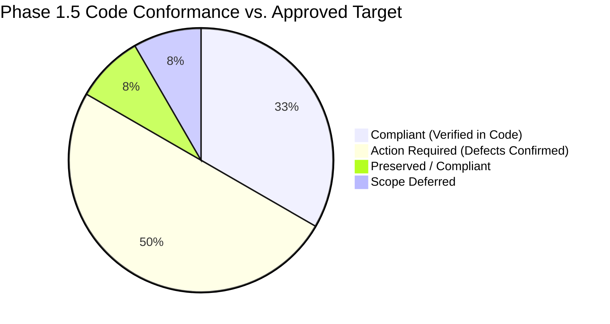
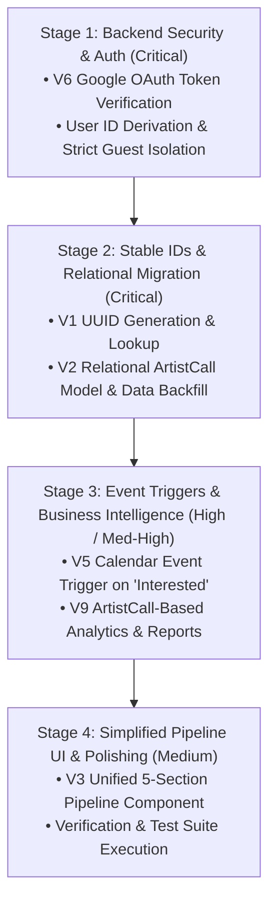

# Tikorix — Source-Code Inspection & Remediation Plan (Reconciled)
## Phase 1.5: Empirical Codebase Audit Reconciled with Phase 2 Architecture Decisions

**Document Version:** 2.0.0  
**Audit Date:** 2026-11-05  
**Audited Codebase:** Development Build (`C:\Users\hazel\Downloads\New folder (2)` / `open-calls`)  
**Reference Directives:** [Phase 1: Page Inventory & Data Registry (v1.1.0)](file:///C:/Users/hazel/.gemini/antigravity/brain/083c6515-2573-4029-b957-2f842dc9822d/website_architecture_audit_phase1.md), Phase 2 Architecture Review Decisions (2026-11-05)  
**Status:** Reconciled & Approved Implementation Roadmap Established  

---

## 1. Project & Implementation Context

Tikorix is currently in pre-launch stage with **no live production users**.

* **Development Build Baseline:** The current codebase is treated as a development build. Direct structural refactoring is permitted and encouraged where necessary to cleanly implement the approved architecture.
* **No Artificial Compatibility Debt:** No unnecessary backward-compatibility shims, dual-write layers, or zero-downtime workarounds should be built to preserve flawed legacy structures.
* **Data Safety & Integrity:** Valid existing data and confirmed workflows must be preserved. A full backup of code and data sheets must precede major migration activities.
* **Verification Prerequisite:** Formal code changes and end-to-end automated tests are strictly required before any verification item can be marked as implemented or compliant. Architectural agreement alone does not change code status.

---

## 2. Executive Summary & Verification Conformance

All 12 Verification Items (`V1` through `V12`) have been re-evaluated and reconciled against the confirmed Phase 2 architecture decisions.

### Current Implementation Status Matrix



| ID | Specification Item | Target Scope & Key Rule | Current Implementation Reality | Conformance Status | Priority |
|---|---|---|---|---|---|
| **V1** | Stable IDs (UUIDs) | Immutable UUIDs for `OpenCall`, `Artist`, `ArtistCall`. No row numbers/titles as keys. | Code uses physical row numbers (`b.row`, `#/entry/:row`). | ❌ **Non-Compliant** | **Critical** (Stage 2) |
| **V2** | Relational Data Model | 1 OpenCall : N ArtistCalls; 1 Artist : N ArtistCalls. Comma-separated strings eradicated. | `app.js` uses `splitNames()`; `Inbox` stores comma strings. | ❌ **Non-Compliant** | **Critical** (Stage 2) |
| **V3** | Artist Pipeline Tables | Single `#/artists` page with 5 collapsible dropdown sections; 1 reusable table component, shared column config. | Accordions inside opportunity view or rigid synchronised layout; lacks unified 5-table component. | ⚠️ **Partially Compliant** | **Medium** (Stage 4) |
| **V4** | ArtistCall Independence | Independent lifecycle states and notes per artist per opportunity. | Verified: writes strictly to target artist's private sheet (`Part2_Lifecycle.js`). | ✅ **Compliant** | **Preserve** |
| **V5** | Calendar Integration | Individual calendar event created strictly when `ArtistCall` reaches **`Interested`** (artist approval). | Shared calendar event triggered prematurely on any `Inbox` edit via `syncCalendar_`. | ❌ **Non-Compliant** | **High** (Stage 3) |
| **V6** | Backend Authentication | Verified Google ID token for all mutations; server derives user; local guest mode technically isolated. | Some endpoints accept unverified `b.personId`; bypassable in dev without env isolation. | ❌ **Non-Compliant** | **Critical** (Stage 1) |
| **V7** | Sync Propagation Safety | Master edits update shared metadata without overwriting artist-specific notes/status. | Verified: `COPY_TO_ARTIST` in `Part2_Lifecycle.js` copies only safe macro fields. | ✅ **Compliant** | **Preserve** |
| **V8** | 13-Route Architecture | All 13 routes and Google Doc Review methods (Clipboard, Docs, Email) supported. | Verified: `onRoute()` handles 13 routes; `renderDocReview()` supports all 3 modes. | ✅ **Compliant** | **Preserve** |
| **V9** | Analytics Calculations | Metrics computed from correct entity: Acceptance/Success rates strictly from `ArtistCall`. | Rates currently aggregated from `Inbox` row counts in `Reports.js`. | ❌ **Non-Compliant** | **Med–High** (Stage 3) |
| **V10** | Drive Folder Hierarchy | Scoped directory structure: `Artist Root / ArtistCalls / [ID] / Payments /`. | Verified: provisioned correctly in `Part2_Artists.js` & `Part2_Docs.js`. | ✅ **Compliant** | **Preserve** |
| **V11** | General Change History | Previous/new value diff logging on general field mutations. | Only approval events are logged; general field history not implemented. | ⏸️ **Deferred** | **Future Scope** |
| **V12** | Send to Artist Actions | Preserve all 3 existing action entry points (Row 3-dot menu, preview half-pane, bulk action). | Actions currently present in UI. Team internal approval required before bulk pitch. | ✅ **Compliant (Preserve)** | **Preserve** |

---

## 3. Detailed Verification Reconciliations (V1 – V12)

### `V6. Backend Authentication & Identity Verification` — ❌ NON-COMPLIANT
* **Phase 2 Approved Directive:** **First implementation task (Critical Priority).** Google authentication is mandatory in production. The backend must independently verify the Google OAuth identity token for every mutation request and derive the acting User ID from that verification. Client-supplied `personId` values must never be trusted for identity or audit attribution. All 4 team members retain equal administrative/operational permissions. Guest mode remains strictly for local offline development and must be technically isolated so that it is impossible to activate in production.
* **Empirical Code Reality:**
  * In `Part1_Inbox.js:117` and `Part2_Lifecycle.js:12`, multiple endpoints trust `b.personId` directly from the request payload:
    ```javascript
    recordApproval_('call', ref, title, b.personId || '');
    ```
  * In `Auth.js`, `verifyIdToken_` exists but is not universally applied as a mandatory gatekeeper on `doPost`.
* **Action Required:**
  1. Implement strict Google ID token verification middleware on all mutation endpoints.
  2. Reject missing, invalid, or expired tokens immediately.
  3. Derive the acting user email/ID exclusively from the verified token.
  4. Ensure guest mode requires explicit local environment flags (`ENV=local_development`) and cannot be triggered in production.

---

### `V1 + V2. Stable IDs & Relational Data Model Migration` — ❌ NON-COMPLIANT
* **Phase 2 Approved Directive:** **Critical Priority — Combined coordinated migration programme.**
  * **Stable IDs (`V1`):** Every `OpenCall`, `Artist`, and `ArtistCall` must possess an immutable, permanent UUID. UI routes and backend mutation handlers must resolve entities by UUID, not spreadsheet row indexes, titles, or names. Sorting, adding, or deleting sheet rows must never affect targeting.
  * **ArtistCall Routing & Resolution:** ArtistCall routes must use `#/artist-call/:artistCallId`. The application must resolve the associated `Artist` and `OpenCall` exclusively through the `ArtistCall`'s stored IDs (`artistId`, `openCallId`), never through artist names, open call titles, or spreadsheet row numbers.
  * **Relational Structure (`V2`):** Core entities are `OpenCall` (master opportunity), `Artist` (profile), and `ArtistCall` (application journey). 1 OpenCall has $N$ ArtistCalls; 1 Artist has $N$ ArtistCalls; each ArtistCall links exactly 1 Artist and 1 OpenCall. Each artist has 1 sheet containing all their ArtistCalls and 1 central Drive folder. Comma-separated artist strings in `Inbox` are retired as relational truth.
  * **Migration Rules:** Legacy comma-separated strings must be mapped to distinct `ArtistCall` records. Ambiguous names or duplicate candidates must be flagged for manual review—never automatically merged. Original raw strings must be preserved in backup columns until verified.
  * **Atomic Orchestration:** Creating an `ArtistCall` coordinates 4 steps: (1) Generate UUID, (2) Insert record into artist's Google Sheet, (3) Create individual Google Drive folder, (4) Link all entities via UUIDs. Partial failures must halt and flag; no silent success.
* **Empirical Code Reality:**
  * Endpoints currently bind to sheet row numbers (`Number(b.row)` in `Part1_Inbox.js:33` and `Part2_Lifecycle.js:8`).
  * Routing binds to row numbers (`#/entry/${c.row}`) and composite encoded names (`#/artist-call/${encodeURIComponent(n.artist)}/${n.row}`).
  * `app.js` relies on `splitNames()` across 13 distinct call sites.
* **Action Required:**
  1. Add immutable UUID fields to master `Inbox` and artist sheets.
  2. Run migration script to backfill UUIDs and extract `ArtistCall` relationship rows.
  3. Update router and GAS endpoints to query and resolve by UUID (`#/entry/:openCallId`, `#/artist-call/:artistCallId`).
  4. Ensure `#/artist-call/:artistCallId` handler retrieves the associated `Artist` and `OpenCall` by their referenced foreign keys (`artistId`, `openCallId`).

---

### `V5. Google Calendar Integration` — ❌ NON-COMPLIANT
* **Phase 2 Approved Directive:** **High Priority.** The artist lifecycle treats **`Interested`** as artist approval.
  * When an `ArtistCall` transitions to `Interested`, generate its corresponding Google Calendar event.
  * Do NOT create events at `Pitched — Awaiting Response`, `Pitched — Need More Info`, or `Not Interested`.
  * Do NOT wait for `Application` stage or internal team approval to generate the event.
  * Each `ArtistCall` maintains its own distinct calendar event (no multi-artist merged events).
  * If an artist withdraws, update or delete only their individual event.
  * Link external Calendar Event ID to the `ArtistCall` UUID.
* **Empirical Code Reality:**
  * `Calendar.js:25` currently hooks directly into master `Inbox` row edits via `syncCalendar_`, creating a single composite event with title `"Open Call: [Title] ([Artist1], [Artist2])"`.
* **Action Required:**
  1. Remove automatic `syncCalendar_` hook from `Part1_Inbox.js`.
  2. Bind calendar event creation in `Part2_Lifecycle.js` strictly to the transition of an `ArtistCall` into the `Interested` status.
  3. Store `calendarEventId` on the `ArtistCall` record.

---

### `V9. Analytics Base Scoping & Reports` — ❌ NON-COMPLIANT
* **Phase 2 Approved Directive:** **Medium–High Priority.** Metrics must aggregate from their true underlying entity:
  * **Opportunity Reports:** Aggregated from `OpenCall` records.
  * **Artist Reports:** Aggregated from `Artist` records and engagement.
  * **Application Reports & Rates:** Aggregated from `ArtistCall` records (submissions, payments, wins, rejections). Acceptance and success rates must be calculated per `ArtistCall`, not per `OpenCall`.
  * The Analytics view (`#/analytics`) must preserve both high-level visual charts and exportable detailed tables.
* **Empirical Code Reality:**
  * In `Reports.js:140-180`, summary rates divide won/submitted counts stored directly on `Inbox` rows.
* **Action Required:**
  1. Rewrite analytics aggregation queries in `Reports.js` to iterate across `ArtistCall` records.
  2. Update frontend charting and tabular export routines in `app.js`.

---

### `V3. Artist Pipeline Tables` — ⚠️ PARTIALLY COMPLIANT
* **Phase 2 Approved Directive:** **Medium Priority.**
  * The Artist Pipeline remains a single page (`#/artists`) featuring **five collapsible dropdown sections**: `Pitched`, `Interested`, `Application`, `Application Sent`, `Outcome (Accepted / Declined)`.
  * To avoid code bloat and maintenance overhead, implement **one reusable table component** driven by **one shared column configuration** across all five sections.
  * Do NOT create five separate bespoke table systems.
  * Do NOT move sections onto separate pages.
  * Do NOT force the Inbox view and Artist Pipeline view to share identical column schemas.
* **Empirical Code Reality:**
  * Currently rendered as nested accordions inside opportunity views or with an inconsistent schema.
* **Action Required:**
  1. Implement a unified table component in `app.js` that renders each of the 5 pipeline sections using the shared column configuration.
  2. Filter each section's table by the corresponding `ArtistCall` lifecycle status.

---

### `V12. Send to Artist Actions` — ✅ COMPLIANT (Preserve Existing)
* **Phase 2 Approved Directive:** **Preserve existing functionality.**
  * Do NOT remove `Send to artist` actions.
  * Retain all 3 current access points: (1) Table row 3-dot menu, (2) Half-pane preview action bar, (3) Bulk-selection action.
  * Enforce the agreed requirement for internal team review before bulk pitching occurs.
* **Empirical Code Reality:**
  * Code contains `Send to artist` in row popovers (`app.js:19877`) and half-pane preview (`app.js:34340`).
* **Resolution:** Reconciled from prior Phase 1.5 recommendation. The buttons are legitimate approved user paths and must be maintained.

---

### `V11. General Change History` — ⏸️ DEFERRED
* **Phase 2 Approved Directive:** Deferred to a future release. Comprehensive field-level change history (diff logging on every cell edit) is excluded from the current remediation scope.
* **Architecture Obligation:** Maintain clean separation of mutation concerns so an audit layer can be plugged in later without extensive rework.

---

### `V4, V7, V8, V10. Existing Compliant Functionality` — ✅ COMPLIANT (Preserve)
The empirical audit verified that the following areas meet specifications:
* **V4 (ArtistCall Independence):** Writes to artist-specific sheets without side-effects on peers.
* **V7 (Sync Propagation Safety):** Master updates copy only safe macro fields (`COPY_TO_ARTIST`), protecting artist statuses.
* **V8 (13-Route Architecture & Doc Review):** Router covers all 13 paths; Google Doc Review supports Clipboard, Docs, and Email.
* **V10 (Drive Folder Provisioning):** Correctly partitions `Artist Root / ArtistCalls / [ID] / Payments /`.

---

## 4. Prioritized Implementation Roadmap

Following Phase 2 priority directives, remediation is organized into four sequential engineering stages:



### Stage 1: Backend Security & Identity Verification (Critical — Task 1)
* **Objective:** Secure mutations against identity spoofing and establish strict production/test isolation.
* **Tasks:**
  1. Add `verifyGoogleToken_(idToken)` middleware to all Google Apps Script mutation handlers (`doPost`).
  2. Derive `actingUserId` from verified tokens; remove trust in client-supplied `b.personId`.
  3. Technically isolate local guest mode (active only when explicit local development environment configuration is set).
* **Acceptance Criteria:** Unauthenticated requests fail with HTTP 401; authenticated team members execute permitted actions; client cannot impersonate others.

### Stage 2: Stable IDs & Relational Data Migration (Critical — Task 2)
* **Objective:** Replace physical row numbers and comma-separated strings with immutable UUIDs and relational `ArtistCall` entities.
* **Tasks:**
  1. Back up all Google Sheets and source scripts.
  2. Implement UUID generator for `OpenCall`, `Artist`, and `ArtistCall`.
  3. Run legacy migration script:
     * Convert confident artist–opportunity associations to relational `ArtistCall` records.
     * Flag unmatched names or duplicate candidates for manual curation (no auto-merging).
     * Retain original raw string columns as backup.
  4. Refactor backend endpoints (`Part1_Inbox.js`, `Part2_Lifecycle.js`) to look up records by UUID.
  5. Refactor frontend router (`app.js`) to use UUIDs (`#/entry/:openCallId`, `#/artist-call/:artistCallId`).
  6. Ensure `#/artist-call/:artistCallId` resolves linked `Artist` and `OpenCall` records strictly through the stored IDs (`artistId`, `openCallId`), eliminating any reliance on names or sheet row numbers.
  7. Implement atomic orchestration for `ArtistCall` creation (UUID + Sheet row + Drive folder + Linkage).
* **Acceptance Criteria:** Sorting or reordering sheet rows causes zero targeting errors. No comma strings parsed as source of truth. Routing directly resolves records via stored IDs.

### Stage 3: Lifecycle Calendar Triggers & Scoped Analytics (High / Med-High)
* **Objective:** Align Google Calendar events with artist approval (`Interested`) and correct KPI reporting math.
* **Tasks:**
  1. Decouple `syncCalendar_` from master `Inbox` saves.
  2. Implement calendar event creation listener on `ArtistCall` status change to `Interested`.
  3. Ensure calendar deletion/update is scoped strictly to the individual `ArtistCall`.
  4. Refactor `Reports.js` analytics functions to calculate acceptance rates, win rates, and stage drop-offs from `ArtistCall` rows.
  5. Verify dashboards and exportable report tables reflect `ArtistCall` metrics.
* **Acceptance Criteria:** Calendar events generate only when an artist is marked `Interested`. Analytics calculate accurate per-application success rates.

### Stage 4: Simplified 5-Section Artist Pipeline UI (Medium)
* **Objective:** Provide clear artist lifecycle visibility without table code duplication.
* **Tasks:**
  1. Build a single reusable table component in `app.js` with a shared column configuration.
  2. Mount 5 collapsible dropdown sections on `#/artists`: `Pitched`, `Interested`, `Application`, `Application Sent`, `Outcome`.
  3. Retain all `Send to artist` triggers across row menus, half-pane preview, and bulk action bars (with internal approval check).
* **Acceptance Criteria:** Each of the five pipeline sections is independently expandable and collapsible on the same Artist Pipeline page; no requirement for a global expand/collapse action; data displays accurately; code maintains clean DRY architecture.

---

## 5. Summary & Next Steps

This document formally aligns the Phase 1.5 code audit with the binding Phase 2 architectural decisions.

1. **Immediate Execution:** Begin **Stage 1 (V6 Backend Authentication)**.
2. **Migration Preparation:** Prepare data backup routines and migration scripts for **Stage 2 (V1 + V2 Data Migration)**.
3. **Status Integrity:** Verification items will transition from ❌ to ✅ only after corresponding code modifications and automated test verifications are completed.
