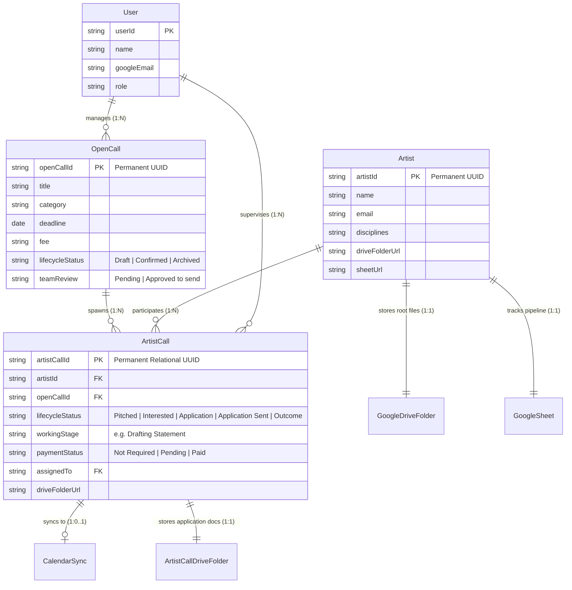
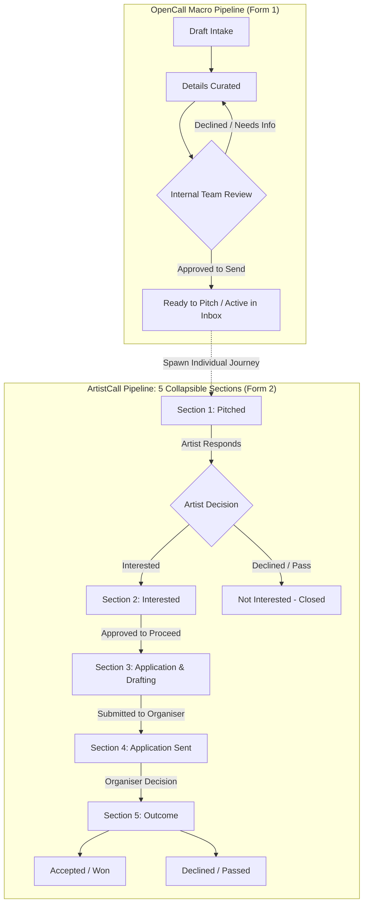

# Tikorix — Website Architecture Audit
## Phase 1: Page Inventory & Data Registry (Reconciled Specification)

**Document Version:** 1.1.0 (Reconciled)  
**Document Status:** Design Reconciliation Complete  
**Implementation Verification:** Pending Independent Source-Code Inspection  
**Scope:** 13 Routes, 11 Entities, Page Dependencies, Data Relationships, Lifecycle Architecture, and Consistency Rules  
**Audited Platform:** Tikorix Art Management Platform (`http://localhost:8787`)  

---

## 1. Audit Scope & Status

This document establishes the authoritative, agreed architectural specification for the Tikorix Art Management Platform. It synthesizes the foundational audit with the structural design decisions ratified during architectural review.

### Foundational Distinction
* **Confirmed Architecture:** The intended target state, design rules, lifecycle pipelines, and entity relationships formally agreed upon during architectural review.
* **Implementation Verification:** Whether the current codebase (`app.js`, `index.html`, `styles.css`, and Google Apps Script backend files) faithfully and safely implements those decisions has **not yet been independently established**.

> [!IMPORTANT]
> Any prior assertion that 100% of the active codebase conforms to this specification is explicitly marked as **Unverified**. All actual code-level conformance remains subject to empirical source-code inspection and rigorous testing.

---

## 2. Page Inventory (13 Documented Routes)

The platform comprises 13 distinct functional routes:

| No. | Page Name | Route | Primary Purpose | Template Type |
|---|---|---|---|---|
| **1** | Workspace Overview | `#/dashboard` | Operational KPIs, closing soon items, urgent reminders, and recent applications. | Executive Dashboard |
| **2** | Open Calls Active Inbox | `#/inbox` | Master directory of confirmed, active opportunities. | Master-Detail Directory |
| **3** | Drafts Queue | `#/drafts` | Review, curate, and confirm unconfirmed extracted/draft opportunities. | Master-Detail Directory |
| **4** | Archive | `#/archive` | Cold storage repository of expired, declined, or closed opportunities. | Master-Detail Directory |
| **5** | Automated Scraper Intake | `#/add` | Ingest and extract structured opportunity fields from external URLs and text. | AI Extraction Tool |
| **6** | Manual Opportunity Intake | `#/new` | Manual entry form for creating new OpenCall records. | Form (Curation Intake) |
| **7** | Opportunity Curation & Edit | `#/entry/:id` | Detailed curation, metadata editing, and mandatory internal team approval. | Form (Curation Intake) |
| **8** | Artist Pipelines Overview | `#/artists` | Master pipeline tracking individual artist opportunity journeys. | 5-Section Pipeline |
| **9** | Artist Dossier | `#/artist/:id` | Consolidated artist profile details, biography, and storage links. | Entity Dossier |
| **10** | ArtistCall Wizard | `#/artist-call/:artist/:id`| Comprehensive wizard managing an individual artist's journey for one call. | Interactive Wizard |
| **11** | Google Doc Review | `#/doc-review/:artist` | Compilation, formatting, and delivery tool for presenting opportunities to artists. | Delivery Workspace |
| **12** | Performance & Analytics | `#/analytics` | Visual dashboards, KPI trends, and filterable reporting engines. | Analytics & Reporting |
| **13** | Settings | `#/settings` | Platform configuration for categories, custom fields, reminders, and team profiles. | Multi-Tab Configuration |

---

## 2.1 Detailed Page Specifications

### 1. Workspace Overview (`#/dashboard`)
* **Purpose:** High-level operational command center.
* **Data Sources (Read-Only):** `OpenCall`, `ArtistCall`, `User`, `Reminder`.
* **Actions Available:** Reminder snoozing, task completion, quick navigation to records.
* **Architectural Rule:** Master `OpenCall` and `ArtistCall` records are strictly read-only on this surface.

### 2. Open Calls Active Inbox (`#/inbox`)
* **Purpose:** Central operational directory of master `OpenCall` opportunities.
* **Capabilities:** Full-text search, category filtering, multi-column sorting, row selection.
* **Lifecycle Boundary:** Manages macro opportunity details, internal team approval, and assignment. **Does not directly mutate individual `ArtistCall` lifecycle stages.**
* **Relationship Linkage:** Uses relational `ArtistCall` records to identify and surface tagged artists (eliminating legacy comma-separated strings).

### 3. Drafts Queue (`#/drafts`)
* **Purpose:** Staging area for in-progress or newly ingested opportunities awaiting review.
* **Capabilities:** Form field validation, inline editing, draft deletion, and promotion to Active Inbox upon confirmation.

### 4. Archive (`#/archive`)
* **Purpose:** Long-term storage for closed, expired, or non-viable opportunities.
* **Capabilities:** Record restoration to Active Inbox and permanent deletion.
* **Deferred Governance:** Permanent-deletion retention schedules (e.g. 30-day purge vs. immediate hard delete) remain subject to final review.

### 5. Automated Scraper Intake (`#/add`)
* **Purpose:** AI-assisted opportunity extraction from raw text, email briefs, and URLs.
* **Capabilities:** Parses unstructured text via Gemini AI into structured opportunity fields. Allows review and editing prior to saving.
* **Architectural Rule:** No separate permanent raw scraper cache is retained; output is committed directly as a Draft or Inbox `OpenCall`.

### 6. Manual Opportunity Intake (`#/new`)
* **Purpose:** Direct manual entry for new opportunities.
* **Form Structure (Form 1):** Captures macro facts (`Title`, `Link`, `Theme`, `Dates`, `Fees`, `Eligibility`).
* **Header & Action Standards:** Clean title (`New Open Call`), status badge (`Draft Intake`), and sticky footer trio (`[ Cancel ]`, `[ Save Draft ]`, `[ Save to Inbox ]`).

### 7. Opportunity Curation & Edit (`#/entry/:id`)
* **Purpose:** Curatorial review, refinement, and internal governance.
* **Mandatory Gateway:** An opportunity **must receive internal team approval** (`team review = 'Approved to send'`) before it can be pitched to artists.
* **State Behavior:** An approved `OpenCall` remains active and visible in the Inbox even if zero `ArtistCall` records have yet been spawned.

### 8. Artist Pipelines Overview (`#/artists`)
* **Purpose:** Operational pipeline managing artist placement journeys.
* **Views Supported:** Universal "All Artists" aggregate view and individual artist dedicated views.
* **Structure:** Contains **five separate collapsible dropdown sections**, each containing its own independent table:
  1. `Section 1: Pitched`
  2. `Section 2: Interested`
  3. `Section 3: Application`
  4. `Section 4: Application Sent`
  5. `Section 5: Outcome`
* **Table Independence Rule:** The table component is modular and reusable; **each page and section independently configures its own columns, widths, sorting, and action sets.** A rigid identical 8-column layout across all tables is explicitly rejected.
* **Interaction Boundary:** Lifecycle Status and Working Stage are display-only in table rows; modifications occur strictly inside the **ArtistCall Wizard**.
* **Bulk Pitching Workflow:**
  $$\text{Select Existing ArtistCalls} \longrightarrow \text{Review Pitch Batch} \longrightarrow \text{Confirm Internally} \longrightarrow \text{Dispatch} \longrightarrow \text{Update to 'Pitched'}$$
  *(Failed dispatches must never be marked as successfully pitched).*

### 9. Artist Dossier (`#/artist/:id`)
* **Purpose:** Clean, non-cluttered profile view for an artist.
* **Core Contents:**
  1. Artist profile details (Bio, Statement, Disciplines, Contacts, Portfolio).
  2. Authoritative link to the artist's Google Drive master folder.
  3. Authoritative link to the artist's private Google Sheet.
* **Action Separation:**
  * `[ View Dossier & Files ]`: Opens the consolidated Google Drive storage structure.
  * `[ View Profile ]`: Opens the central `Artist` record for biographical editing.

### 10. ArtistCall Wizard (`#/artist-call/:artist/:id`)
* **Purpose:** Dedicated interactive workspace managing one artist's journey for one opportunity.
* **Contents:**
  * Inherited read-only opportunity facts from `OpenCall`.
  * `Lifecycle Status` (single source of truth for journey progress).
  * `Working Stage` (fine-grained task tracking, e.g., Drafting Statement).
  * `Payment Status` (independent: `Not Required`, `Pending`, `Paid`).
  * Direct link to the individual `ArtistCall` Google Drive folder.

### 11. Google Doc Review (`#/doc-review/:artist`)
* **Purpose:** Curatorial compilation and presentation engine.
* **Delivery Modalities:**
  1. **Clipboard:** Formatted markdown/plain-text copy.
  2. **Google Doc:** Automated creation/update of an external Google Doc.
  3. **Email:** Direct email dispatch to the artist.
* **Critical Boundary:** Internal curatorial approval to present opportunities is distinct from an artist's consent to apply. Compilation and delivery **must not automatically alter `ArtistCall` lifecycle statuses**.

### 12. Performance & Analytics (`#/analytics`)
* **Visual Dashboards:** KPI summary cards, conversion charts, pipeline volume trends.
* **Detailed Reports:** Filterable data tables with CSV export across three distinct categories:
  1. **Opportunity Reports:** Aggregates by type, discipline, fees, and funding.
  2. **Artist Reports:** Artist engagement, roster participation, and win counts.
  3. **Application Reports:** Individual `ArtistCall` journeys, submissions, fees paid, and outcome rates.
* **Metric Calculation Rule:** All acceptance rates, win rates, and application success metrics **must be calculated from `ArtistCall` records, not `OpenCall` records.**

### 13. Settings (`#/settings`)
* **Sections:** Categories, Custom Form Fields, Reminders, Reporting Parameters, and Team & Users.
* **User Architecture:** Supports 4 team members with equal operational permissions. Assignment indicates responsibility, not access restriction. Authentication relies on backend Google identity verification.

---

## 3. Modal and Slide-Over Inventory

The interface utilizes structured overlays categorized by functional purpose:

| Overlay Component | Implementation Type | Purpose |
|---|---|---|
| **Slide-over Drawer** | Right-hand slide-over panel | Settings, category management, reminder configurations, notifications. |
| **Artist Dossier Modal** | Centered 2-column modal | Artist biographical editing, profile inspection, and dossier links. |
| **Quick Add Artist Dialog** | Focused centered modal | Rapid onboarding of new artists to the Google Sheet roster. |
| **Team User Selector** | Centered popover modal | Assigning internal staff members (`People` / `Team`) to opportunities. |
| **Half-Pane Preview** | Split-view layout container | Rapid desktop previewing of open call records alongside directory tables. |
| **Google Sign-In** | Full-screen authentication gate | OAuth token exchange and backend identity verification. |

---

## 4. Entity & Field Registry (11 Documented Entities)

### 4.1 Primary Domain Entities



#### A. OpenCall (Master Opportunity Record)
* **Unique Identifier:** Permanent, immutable `OpenCall ID` (Row indices and titles are strictly non-authoritative).
* **Fields:** Identity (`ID`, `Title`, `Source URL`), Classification (`Type`, `Discipline`, `Location`, `Eligibility`), Financials (`Fee Amount`, `Funding Structure`), Dates (`Opening Date`, `Deadline`, `Event Dates`), Review (`Team Review`, `Approval Date`), Management (`Status`, `Assigned User`).
* **Governance Rule:** No comma-separated artist strings. Eligible or pitched artists are discovered exclusively via relational `ArtistCall` records.

#### B. Artist (Master Profile)
* **Unique Identifier:** Permanent, immutable `Artist ID`.
* **Fields:** Identity (`ID`, `Name`), Profile (`Bio`, `Statement`, `Disciplines`, `Mediums`), Contact (`Email`, `Phone`, `Location`), Links (`Website`, `Portfolio`), Storage (`Drive Folder URL`, `Google Sheet URL`).
* **Governance Rule:** Each artist maintains exactly one master record, one root Google Drive folder, and one tracking Google Sheet.

#### C. ArtistCall (Relational Join Entity)
* **Unique Identifier:** Permanent, immutable `ArtistCall ID`.
* **Nature:** The core relationship entity between `Artist` and `OpenCall`. It is an independent journey, not a cloned opportunity record.
* **Fields:** Relational Keys (`ArtistCall ID`, `Artist ID`, `OpenCall ID`), Inherited Opportunity Facts (Read-only mirror), Progression (`Lifecycle Status`, `Working Stage`, `Payment Status`, `Assigned User`, `Key Dates`, `Notes`, `Drive Folder URL`).
* **Independence Rule:** Mutating one `ArtistCall` has zero side-effects on peer `ArtistCall` records linked to the same `OpenCall`.

#### D. User (Authenticated Team Member)
* **Fields:** `User ID`, `Name`, `Google Account Email`, `Role`, `Preferences`.
* **Architecture:** Fixed team of 4 staff members with equal operational access. Backend authentication must verify actual Google identity tokens.

### 4.2 Supporting Entities

| Entity | Primary Responsibility | Storage Destination |
|---|---|---|
| **Category** | Controlled taxonomies for disciplines, types, and eligibility. | Google Sheet `Categories` |
| **FormField** | Dynamic custom field configuration (OpenCall, ArtistCall, or both). | Google Sheet `Form fields` |
| **Reminder** | Scheduled automated prompts for follow-ups, closing calls, and results. | Google Sheet `Reminders` |
| **ReminderLog**| Lightweight audit trail of reminder dispatches and completions. | Google Sheet `Reminder Log` |
| **Report** | Saved query configurations and analytic export schemas. | Client State / In-Memory |
| **FileAsset** | Drive folder references, dossier links, and payment receipts. | Google Drive Hierarchy |
| **CalendarSync**| External Google Calendar event ID mappings and sync health. | Google Calendar API |

---

## 5. Storage Hierarchy & Google Drive Architecture

To eliminate file sprawl and accidental overwrites, storage is strictly partitioned:

```
[Google Drive: Artist Root Folder] (e.g. /Tikorix/Artists/Harsha/)
  ├── Profile/
  │     ├── CV.pdf
  │     ├── Artist_Statement.pdf
  │     └── Headshot.jpg
  └── ArtistCalls/
        ├── [ArtistCall_ID_Summer_Residency]/
        │     ├── Application_Form.pdf
        │     ├── Dossier_Proposal.pdf
        │     └── Payments/
        │           └── Fee_Receipt.pdf
        └── [ArtistCall_ID_Autumn_Grant]/
              └── Submission_Confirmation.pdf
```

* Every `ArtistCall` automatically provisions its own subfolder within the artist's Drive directory.
* Application fees and receipts are routed into the `Payments/` subfolder inside that specific `ArtistCall` directory, never at the top-level artist root.

---

## 6. ArtistCall Lifecycle & Pipeline Architecture

The **OpenCall Curation Pipeline** and the **ArtistCall Placement Pipeline** operate independently:



### Lifecycle Rules & State Integrity
1. **Separation of Approvals:** Internal curatorial approval (`team review`) allows an opportunity to be pitched. It does not imply artist approval. Only **explicit artist approval** advances an `ArtistCall` to `Application` and triggers calendar event generation.
2. **Working Stage vs. Lifecycle Status:** `Lifecycle Status` governs the high-level section. `Working Stage` tracks granular micro-tasks (e.g. `Drafting Statement`, `Gathering Images`). Changing working stage never alters lifecycle status automatically.
3. **Payment Decoupling:** `Payment Status` (`Not Required`, `Pending`, `Paid`) is an independent financial tracking property and does not block pipeline stage progression.

---

## 7. Shared Data & Synchronisation Model

* **Authoritative Master:** `OpenCall` is the sole source of truth for macro opportunity data (Title, Organizer, Deadline, Fees, Application Link, Categories).
* **Propagation Pipeline:** When an `OpenCall` field is edited, changes propagate automatically to all linked `ArtistCall` records.
* **Non-Destructive Boundary:** Propagation **must never overwrite** an `ArtistCall`'s `Lifecycle Status`, `Working Stage`, `Payment Status`, or private notes.
* **Calendar Sync Isolation:** Calendar events are keyed to specific `ArtistCall` IDs. If an artist withdraws or passes, only their corresponding calendar event is updated or cancelled.

---

## 8. Source-Code Inspection & Verification Plan

Before Phase 1 implementation compliance can be declared, the following **12 Empirical Verifications** must be conducted directly against the codebase:

| Verification Item | Target Files | Code-Level Verification Criterion | Status |
|---|---|---|---|
| **V1. Stable ID Implementation** | `app.js`, `Part1_Inbox.js`, `Part2_Artists.js` | Confirm records use persistent UUIDs rather than transient Sheet row numbers (`rowId`). | **Pending Inspection** |
| **V2. Relational Linkages** | `app.js`, `index.html` | Verify removal of comma-separated `artists` strings in favor of relational lookups. | **Pending Inspection** |
| **V3. Independent Tables** | `app.js:renderPipeline`, `styles.css` | Verify 5 independent collapsible section tables with configurable column schemas. | **Pending Inspection** |
| **V4. ArtistCall Independence** | `Part2_Lifecycle.js`, `app.js` | Verify advancing one artist's status leaves sibling `ArtistCall` records completely untouched. | **Pending Inspection** |
| **V5. Calendar Event Scope** | `Calendar.js` | Confirm calendar events map to single `ArtistCall` records and require artist approval. | **Pending Inspection** |
| **V6. Backend Identity Check** | `Auth.js`, `Main.js` | Verify Google OAuth tokens are validated server-side rather than trusting client strings. | **Pending Inspection** |
| **V7. Sync Propagation Safety** | `Part1_Inbox.js` | Confirm `OpenCall` updates safely patch linked `ArtistCall` records without data loss. | **Pending Inspection** |
| **V8. 13-Route Architecture** | `app.js:onRoute` | Confirm router properly handles all 13 documented routes including `#/doc-review`. | **Pending Inspection** |
| **V9. Analytics Base Data** | `Reports.js`, `app.js` | Confirm acceptance rates and KPIs are calculated from `ArtistCall` counts, not `OpenCall`. | **Pending Inspection** |
| **V10. Drive Folder Hierarchy**| `Part2_Docs.js`, `gas-env.js` | Verify folder provisioning routes application files to `ArtistCalls/[ID]/Payments/`. | **Pending Inspection** |
| **V11. Change Audit Logging** | `Part2_Lifecycle.js` | Verify recording of previous value, new value, user identity, and timestamp on mutation. | **Pending Inspection** |
| **V12. De-duplication of Menus**| `app.js`, `index.html` | Confirm complete removal of `Send to artist` from table 3-dots menus. | **Pending Inspection** |

---

## 9. Conclusion & Phase Gate

* **Architectural Specification Reconciliation:** **Complete & Approved.**
* **13-Route Inventory & Specifications:** **Formally Documented.**
* **11-Entity Relational Data Model:** **Formally Documented.**
* **Dual-Pipeline Separation Model:** **Formally Documented.**
* **Codebase Conformance Verification:** **Pending Source-Code Inspection (Phase 1.5).**

The agreed architectural specification is locked. The next operational step is conducting the independent source-code inspection against the 12 verification items.
