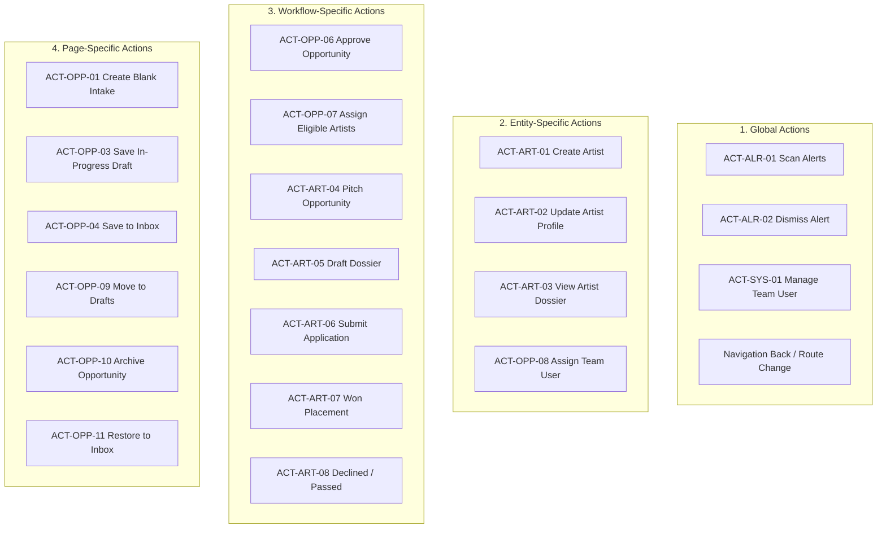
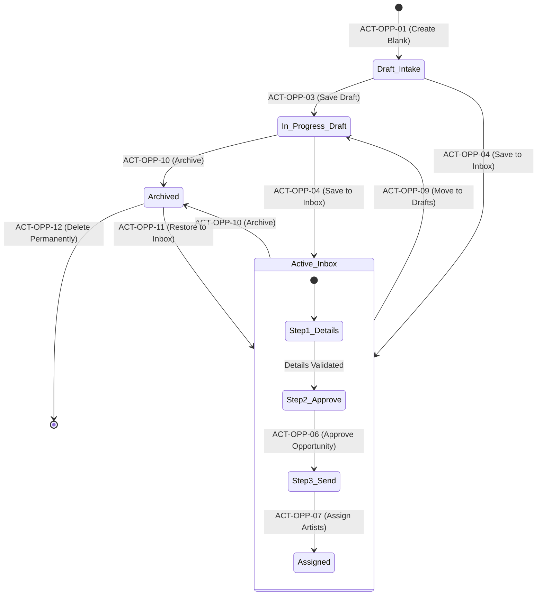
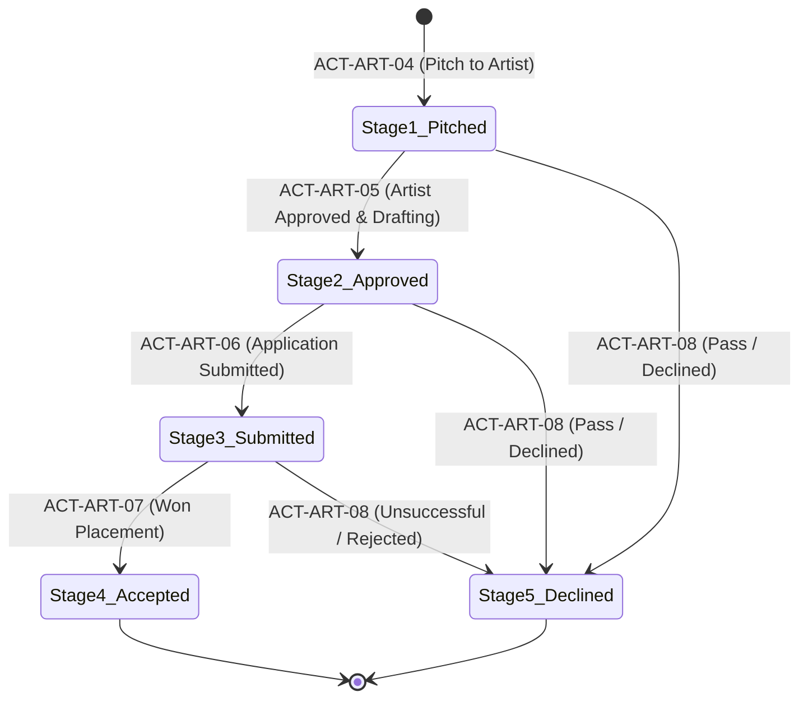
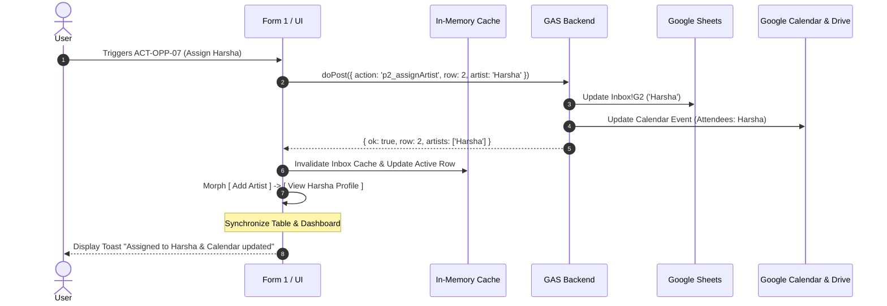

# Website Architecture: Phase 3 — Shared Actions & Workflow Architecture

**Version:** 3.0.0  
**Phase:** 3 of 4 (Page Inventory &rarr; Component Library &rarr; **Shared Actions & Workflow Architecture** &rarr; Integration)  
**Status:** Ready for Review & Approval  
**Audited Platform:** Tikorix Art Management Platform (`http://localhost:8787`)  

---

## Executive Summary

Phase 3 establishes a centralised, deterministic system for managing all **user actions, interactive operations, multi-step workflows, and contextual navigation** across the Tikorix platform.

The core objective is **Operational Consistency**: any given action (such as editing an artist dossier, approving an open call, or assigning team ownership) must produce identical data outcomes, run the same validations, and trigger consistent synchronisations regardless of whether the user invokes it from:
- A table row 3-dots menu,
- A sticky form action bar,
- An overview dashboard card, or
- A modal drawer.

> [!IMPORTANT]
> **Architectural Governance:** This document formalises all interaction contracts, permissions, validation rules, and data synchronisation pipelines. In strict accordance with the audit guidelines, **no existing backend or frontend code is modified until this architecture is reviewed and approved.**

---

## PART 1: ACTION DISCOVERY & INVENTORY

An exhaustive audit of all interactive surfaces identified **28 distinct platform actions** spanning 4 functional domains.

### 1. Opportunity Curation & Intake Domain (Form 1)
1. **`ACT-OPP-01` (Create Blank Intake Record)**: Initialises a new manual open call intake record.
2. **`ACT-OPP-02` (AI Document Extraction)**: Ingests raw email text, PDFs, or external URLs via Gemini AI to extract structured opportunity fields.
3. **`ACT-OPP-03` (Save In-Progress Draft)**: Persists partial opportunity fields to `Inbox` sheet with `status = 'Pending'`.
4. **`ACT-OPP-04` (Publish to Active Inbox)**: Commits curated opportunity to `Inbox` sheet with `status = 'Confirmed'`.
5. **`ACT-OPP-05` (Update Opportunity Details)**: Updates metadata, deadlines, fees, or categories on an existing opportunity.
6. **`ACT-OPP-06` (Approve Curated Opportunity)**: Curatorial sign-off (`team review = 'Approved to send'`).
7. **`ACT-OPP-07` (Assign Eligible Artists)**: Tags artists from the master roster onto an opportunity and syncs the Google Calendar event.
8. **`ACT-OPP-08` (Assign Team User)**: Assigns an internal staff curator (`People` / `Team` record) to supervise the opportunity.
9. **`ACT-OPP-09` (Move to Drafts)**: Demotes an active inbox call back to in-progress draft status.
10. **`ACT-OPP-10` (Archive Opportunity)**: Moves an opportunity to the Archive repository.
11. **`ACT-OPP-11` (Restore to Inbox)**: Restores an archived opportunity to the Active Inbox.
12. **`ACT-OPP-12` (Permanently Delete Opportunity)**: Irreversibly purges an opportunity from the Archive.
13. **`ACT-OPP-13` (Open Call Drive Folder)**: Navigates to the authoritative Google Drive storage folder for call assets.

### 2. Artist Dossier & Placement Domain (Form 2)
14. **`ACT-ART-01` (Create Artist Profile)**: Onboards a new artist into the Google Sheet roster (`Artists`) and provisions their private tracking sheet.
15. **`ACT-ART-02` (Update Artist Profile)**: Modifies artist biographical statement, mediums, disciplines, CV, and website.
16. **`ACT-ART-03` (View Artist Dossier)**: Opens the comprehensive 2-column artist dossier modal drawer.
17. **`ACT-ART-04` (Pitch Opportunity to Artist)**: Enrolls an active opportunity into an individual artist's placement pipeline at `Stage 1: Pitched`.
18. **`ACT-ART-05` (Approve Pitch & Draft Dossier)**: Artist accepts opportunity; advances pipeline to `Stage 2: Artist Approved & Dossier Drafting`.
19. **`ACT-ART-06` (Submit Application)**: Formal application submitted to organiser; advances pipeline to `Stage 3: Application Submitted`.
20. **`ACT-ART-07` (Record Acceptance / Won)**: Application accepted; advances pipeline to `Stage 4: Accepted / Won Placement`.
21. **`ACT-ART-08` (Record Decline / Pass)**: Application passed or rejected; advances pipeline to `Stage 5: Declined / Passed`.
22. **`ACT-ART-09` (Upload Dossier File)**: Uploads artist proposals, portfolios, or cover letters to Google Drive.

### 3. Monitoring, Reminders & Alerts Domain
23. **`ACT-ALR-01` (Scan Deadlines & Generate Alerts)**: Scans all active deadlines ($\le 7$ days, $\le 2$ days) and creates notification records.
24. **`ACT-ALR-02` (Dismiss Alert)**: Marks an alert notification as acknowledged/read.
25. **`ACT-ALR-03` (Snooze Alert)**: Postpones an alert notification by 48 hours.

### 4. System Administration & Customization Domain
26. **`ACT-SYS-01` (Create / Edit Team User)**: Manages internal user profiles, roles, and emails in Google Sheet `People`.
27. **`ACT-SYS-02` (Manage Opportunity Categories)**: Adds, renames, or archives categories in Google Sheet `Categories`.
28. **`ACT-SYS-03` (Configure Custom Form Fields)**: Extends opportunity forms with custom schema fields in Google Sheet `Form fields`.

---

## PART 2: ACTION CLASSIFICATION

Every action is categorized into one of four architectural classes:



### Classification Boundary Rules
* **Global Actions**: Operate across multiple entities and layout containers without requiring an active row or record context.
* **Entity-Specific Actions**: Target a single authoritative record (e.g., modifying an Artist in `Artists` sheet) regardless of the view from which they are triggered.
* **Workflow-Specific Actions**: Governed by sequential lifecycle state machines (Form 1 Curation Stepper or Form 2 Placement Pipeline). They enforce pre-conditions and trigger deterministic post-conditions.
* **Page-Specific Actions**: Bound to a specific route container (such as Form 1 sticky footer buttons) that manage transient view state.

---

## PART 3: CENTRAL ACTION REGISTRY

The Action Registry defines the formal operational contract for every platform action.

| Action ID | Action Name | Target Entity | Entry Points | Trigger Element | Input Parameters | Permissions | Behaviour & State Change | Authoritative Destination |
|---|---|---|---|---|---|---|---|---|
| **`ACT-OPP-01`** | `CreateBlankIntake` | `Open Call` | Sidebar link, Table header button | Click `+ Add Open Call` | None | All Staff | Navigates to `#/new`, resets form fields to blank, initializes `Draft Intake` state. | Client State |
| **`ACT-OPP-03`** | `SaveDraft` | `Open Call` | Sticky footer (`#/new`, `#/entry/:id`) | Click `[ Save Draft ]` | Form payload | Curator, Admin | Validates title; saves to `Inbox` with `status = 'Pending'`. | Google Sheet `Inbox` |
| **`ACT-OPP-04`** | `SaveToInbox` | `Open Call` | Sticky footer (`#/new`, `#/entry/:id`) | Click `[ Save to Inbox ]` | Full Form payload | Curator, Admin | Validates required fields; saves to `Inbox` with `status = 'Confirmed'`. Refreshes Inbox table. | Google Sheet `Inbox` |
| **`ACT-OPP-06`** | `ApproveOpportunity` | `Open Call` | Stepper Step 2, Row 3-dots menu | Click `[ Approve Opportunity ]` | `rowId`, `title` | Curator, Admin | Sets `team review = 'Approved to send'`, logs approval timestamp, advances stepper to Step 3. | Google Sheet `Inbox` |
| **`ACT-OPP-07`** | `AssignArtists` | `Open Call` | Stepper Step 3, Form Section 6 | Click Artist Chip | `rowId`, `artistNames[]` | Curator, Admin | Updates `artists` column in `Inbox`; creates/updates Google Calendar event with attendees. | Google Sheet `Inbox` & Calendar |
| **`ACT-OPP-08`** | `AssignTeamUser` | `Open Call` | Row 3-dots menu, Form header | Click `Assign to team user` | `rowId`, `userId` | Curator, Admin | Opens `CMP-MDL-04`; updates `assigned to` in `Inbox` sheet. | Google Sheet `Inbox` |
| **`ACT-OPP-09`** | `MoveToDrafts` | `Open Call` | Card 3-dots menu (`#/entry/:id`) | Click `Move to drafts` | `rowId` | Curator, Admin | Confirms action; updates `status = 'Pending'`; redirects to `#/inbox`. | Google Sheet `Inbox` |
| **`ACT-OPP-10`** | `ArchiveOpportunity` | `Open Call` | Card 3-dots menu, Row 3-dots menu | Click `Archive opportunity` | `rowId` | Curator, Admin | Updates `status = 'Archived'`; removes from active inbox table. | Google Sheet `Inbox` |
| **`ACT-OPP-11`** | `RestoreToInbox` | `Open Call` | Card 3-dots menu (`#/archive`) | Click `Restore to inbox` | `rowId` | Curator, Admin | Updates `status = 'Confirmed'`; restores to active inbox table. | Google Sheet `Inbox` |
| **`ACT-OPP-12`** | `DeletePermanent` | `Open Call` | Card 3-dots menu (`#/archive`) | Click `Delete permanently` | `rowId` | Admin only | Requires explicit modal confirmation; deletes row from `Inbox` sheet. | Google Sheet `Inbox` |
| **`ACT-ART-01`** | `CreateArtist` | `Artist` | Directory button, Form Section 6 | Click `[ + Add Artist ]` | `name`, `email`, `discipline` | Admin, Curator | Opens `CMP-MDL-03`; appends to `Artists` sheet; creates artist Google Sheet. | Google Sheet `Artists` |
| **`ACT-ART-02`** | `UpdateArtistProfile` | `Artist` | Dossier Modal (`CMP-MDL-02`) | Click `[ Save Profile ]` | `artistId`, profile fields | Admin, Curator | Validates email; updates `Artists` sheet row. Updates cache. | Google Sheet `Artists` |
| **`ACT-ART-03`** | `ViewArtistDossier` | `Artist` | Directory row, Morphing pill | Click `[ View {Artist} Profile ]` | `artistName` | All Staff | Loads artist record and past applications into `CMP-MDL-02` drawer. | In-Memory Modal |
| **`ACT-ART-04`** | `PitchOpportunity` | `Application` | Artist Tab header, Form 2 | Click `[ + Pitch Opportunity ]` | `artistName`, `openCallRow` | Curator, Liaison | Appends row to artist's private sheet at `Stage 1: Pitched`. | Private Artist Sheet |
| **`ACT-ART-05`** | `ApprovePitch` | `Application` | 5-Stage Pipeline (`#/artist-call`) | Click `Mark Approved` | `artistName`, `appRow` | Curator, Liaison | Advances stage to `Stage 2: Approved & Drafting`. | Private Artist Sheet |
| **`ACT-ART-06`** | `SubmitApplication` | `Application` | 5-Stage Pipeline (`#/artist-call`) | Click `Mark Submitted` | `artistName`, `appRow`, `date` | Curator, Liaison | Advances stage to `Stage 3: Application Submitted`. | Private Artist Sheet |
| **`ACT-ART-07`** | `RecordWon` | `Application` | 5-Stage Pipeline (`#/artist-call`) | Click `Won Placement` | `artistName`, `appRow`, `notes` | Curator, Admin | Advances stage to `Stage 4: Accepted / Won Placement`. | Private Artist Sheet |
| **`ACT-ART-08`** | `RecordDeclined` | `Application` | 5-Stage Pipeline (`#/artist-call`) | Click `Declined / Passed` | `artistName`, `appRow`, `reason` | Curator, Liaison | Advances stage to `Stage 5: Declined / Passed`. | Private Artist Sheet |
| **`ACT-ALR-02`** | `DismissAlert` | `Reminder` | Slide-over drawer, Overview card | Click `Dismiss` | `alertId` | All Staff | Marks notification read; decrements bell counter (`#globalBellCount`). | Sheet `Reminder Log` |

---

## PART 4: MULTIPLE ENTRY POINT MATRIX

A central vulnerability identified in legacy revisions was that the same action initiated from different surfaces invoked divergent code branches. The matrix below defines the **Single Authoritative Underlying Handler** for all multi-surface actions.

```
+---------------------------------------------------------------------------------------------------------------+
| ACTION             | ENTRY POINTS                                                    | AUTHORITATIVE HANDLER  |
|--------------------|-----------------------------------------------------------------|------------------------|
| View Artist        | 1. Artist Directory card click                                  | `openArtistDossierModal`
| Dossier            | 2. Opportunity Form artist chip -> [ View Profile ] button      | (Single shared modal)  |
|                    | 3. Artist Placement header -> Artist badge                      |                        |
|--------------------|-----------------------------------------------------------------|------------------------|
| Approve            | 1. Form 1 Curation Stepper -> Step 2 [ Approve Opportunity ]    | `p2_approveCall`       |
| Opportunity        | 2. Directory Table -> Row 3-dots menu -> Approve Opportunity    | (Validates permissions)|
|--------------------|-----------------------------------------------------------------|------------------------|
| Assign Team        | 1. Directory Table -> Row 3-dots menu -> Assign to team user    | `openAssignUserModal`  |
| User               | 2. Opportunity Form -> Call Details header -> Assignee pill     | (Dedicated user modal) |
|--------------------|-----------------------------------------------------------------|------------------------|
| Archive            | 1. Directory Table -> Row 3-dots menu -> Archive                | `p2_archiveCall`       |
| Opportunity        | 2. Opportunity Form -> Call Details 3-dots menu -> Archive     | (Updates status field) |
+---------------------------------------------------------------------------------------------------------------+
```

### Architectural Guarantees for Multiple Entry Points
1. **Identical State Mutation**: Invoking `Approve Opportunity` via the table row menu or via the Form 1 stepper executes the exact same GAS API endpoint (`p2_approveCall`).
2. **Context Preservation**: Selecting an artist chip inside Form 1 and clicking `[ View Harsha Profile ]` opens the exact same `ArtistDossierModal` used in the Artist Directory, pre-loaded with Harsha's authoritative data from the `Artists` sheet.
3. **No Duplicate Modals**: The DOM contains exactly one instance of each modal container (`CMP-MDL-01` to `CMP-MDL-04`); entry points merely bind their target ID and open the existing instance.

---

## PART 5: ACTION BEHAVIOUR & STATE MACHINES

Every state transition adheres to strict deterministic rules.

### 1. Form 1: Opportunity Curation Lifecycle State Machine



### 2. Form 2: Artist Placement Pipeline State Machine



### State Validation & Guard Rules
* **Guard 1 (Inbox Publication)**: `ACT-OPP-04 (Save to Inbox)` requires non-empty `Title`, valid `Category`, and an authoritative `Submission Deadline`. If missing, the sticky footer displays inline field errors and prevents submission.
* **Guard 2 (Curation Approval)**: `ACT-OPP-06 (Approve Opportunity)` is blocked unless the opportunity is stored in `Active Inbox` (`status = 'Confirmed'`).
* **Guard 3 (Artist Pipeline Progression)**: An application cannot advance to `Stage 3 (Submitted)` without a verified submission timestamp and linked dossier document.
* **Guard 4 (Destructive Confirmation)**: `ACT-OPP-12 (Delete Permanently)` triggers an explicit confirmation dialog warning that Google Drive files and Google Calendar events will be disassociated.

---

## PART 6: NAVIGATION & CONTEXT PRESERVATION RULES

To prevent navigation disorientation and loss of work, the following navigation contracts are established:

### 1. Route Parameter Contracts
* **Opportunity Route**: `#/entry/:rowId`
  * `:rowId` must be a valid positive integer mapping to a physical row in the `Inbox` sheet.
  * If `:rowId` is invalid or deleted, the router gracefully catches the fault, displays a toast alert (`"Opportunity no longer exists"`), and routes to `#/inbox`.
* **Artist Placement Route**: `#/artist-call/:artistName/:rowId`
  * Both `:artistName` and `:rowId` are mandatory.
  * If the artist does not exist in the roster, the router redirects to `#/artists`.

### 2. Unsaved Changes Guard
* If a user initiates navigation (via `< Back`, sidebar links, or external route change) while form inputs in Form 1 or Form 2 are dirty:
  1. Router intercepts navigation event.
  2. Prompts user: `"You have unsaved changes. Discard and proceed?"`
  3. If confirmed: discards local in-memory modifications and proceeds.
  4. If cancelled: retains form state and aborts navigation.

### 3. Surface Pattern Allocation
To avoid forcing every workflow into the same interaction pattern, surfaces are allocated by cognitive load:

| Surface Pattern | Target Workflows | Architectural Rationale |
|---|---|---|
| **Full Page** | • Opportunity Directory (`#/inbox`)<br>• Opportunity Curation (`#/entry/:id`, `#/new`)<br>• Artist Pipelines (`#/artists`) | High information density requiring multi-column layouts, extensive data fields, and sticky footer controls. |
| **Modal Drawer (2-Column)** | • Artist Profile Dossier (`CMP-MDL-02`) | Allows inspecting deep artist biographies, portfolios, and past history without losing current directory or opportunity context. |
| **Modal Dialog (Centered)** | • Quick Add Artist (`CMP-MDL-03`)<br>• Team User Assignment (`CMP-MDL-04`)<br>• Permanent Delete Confirmation | Focused, short micro-transactions requiring immediate user commitment or dismissal. |
| **Slide-Over Panel (Right)** | • Notifications & Impending Deadlines (`CMP-MDL-05`) | Ephemeral inspection of alerts that overlays current work without interrupting data entry. |
| **Contextual Dropdown** | • Row Actions (`CMP-TBL-03`)<br>• Card Options Menu | Low-friction access to secondary record operations without navigation. |

---

## PART 7: SYNCHRONISATION & PROPAGATION ARCHITECTURE

When an action mutates backend data, changes must propagate cleanly across all dependent surfaces without stale snapshots or race conditions.



### Data Propagation Rules
1. **Master Artist Profile Propagation**:
   * When `ACT-ART-02 (Update Artist Profile)` saves changes to Google Sheet `Artists`:
     * The in-memory artist roster is immediately updated.
     * Open Call form artist chips reflect any name changes.
     * Artist Directory directory cards re-render with updated statement and media.
     * **Historical applications retain historical submission snapshots**; only live reference links are refreshed.
2. **Opportunity Status Propagation**:
   * When `ACT-OPP-06 (Approve Opportunity)` executes:
     * `Inbox` sheet column `team review` updates to `'Approved to send'`.
     * The Opportunity Table row updates its `STAGE` cell from `'Added'` to `'Approved'`.
     * The Form 1 Stepper updates Step 2 dot to completed (`.dot.done`) and reveals Step 3 artist assignment controls.
3. **Calendar Synchronisation**:
   * When an open call deadline or artist assignment changes, the backend `Calendar.js` service synchronises the corresponding Google Calendar event automatically. If no calendar event exists, it is created.

---

## PART 8: PERMISSIONS & VALIDATION MATRIX

| Action ID | Permitted Roles | Pre-Validation Conditions | Post-Execution Checks | Audit Trail Logged |
|---|---|---|---|---|
| **`ACT-OPP-01`** | All Staff | User session active | New blank record initialized | No |
| **`ACT-OPP-03`** | All Staff | `Title` must be non-empty ($\ge 2$ chars) | Row saved to `Inbox` as `Pending` | Yes (`Activity Log`) |
| **`ACT-OPP-04`** | Curator, Admin | `Title`, `Category`, `Deadline` valid | Row saved to `Inbox` as `Confirmed` | Yes (`Activity Log`) |
| **`ACT-OPP-06`** | Curator, Admin | Record must be in `Confirmed` state | `team review` set; Stepper advanced | Yes (User + Timestamp) |
| **`ACT-OPP-07`** | Curator, Admin | Artist exists in `Artists` roster | `artists` column updated; Cal event sync | Yes (`Activity Log`) |
| **`ACT-OPP-08`** | Curator, Admin | Target user exists in `People` sheet | `assigned to` column updated | Yes (User + Timestamp) |
| **`ACT-OPP-10`** | Curator, Admin | Opportunity not already archived | `status = 'Archived'`; Table row removed | Yes (`Activity Log`) |
| **`ACT-OPP-12`** | Admin only | Record stored in `Archived` state | Row deleted from `Inbox` sheet | Yes (`Security Audit`) |
| **`ACT-ART-01`** | Curator, Admin | `Artist Name` unique, valid email | Roster updated, private sheet provisioned | Yes (`Activity Log`) |
| **`ACT-ART-04`** | Curator, Liaison | Artist has active private sheet | Application row created at `Stage 1` | Yes (`Activity Log`) |
| **`ACT-ART-06`** | Curator, Liaison | Dossier document attached | Stage updated to `Stage 3: Submitted` | Yes (Submission Date) |

---

## Summary & Approval Request

Phase 3 Shared Actions & Workflow Architecture provides:
1. **Action Inventory & Classification**: 28 platform actions classified across Global, Entity, Workflow, and Page scopes.
2. **Multiple Entry Point Matrix**: Guaranteed execution parity for shared actions across tables, cards, forms, and modals.
3. **Formal State Machines**: Deterministic lifecycle models for Opportunity Curation (Form 1) and Artist Placement (Form 2).
4. **Navigation Contracts**: Strict route parameter validation, unsaved changes guards, and surface pattern allocation.
5. **Data Synchronisation Pipelines**: Reactive cache invalidation and Google Calendar/Drive propagation rules.

Please review this specification and confirm your approval before we proceed to **Phase 4: Design Tokens & Layout Integration** or implementation.
