# Website Architecture: Phase 4 — Dependency Management, Change Control & Testing

**Version:** 4.0.0  
**Phase:** 4 of 4 (Page Inventory &rarr; Component Library &rarr; Shared Actions &rarr; **Dependency Management, Change Control & Testing**)  
**Status:** Ready for Review & Approval  
**Audited Platform:** Tikorix Art Management Platform (`http://localhost:8787`)  

---

## Executive Summary

Phase 4 concludes the comprehensive **Website Architecture Audit and Governance System** by establishing a centralised, rigorous framework for **Dependency Management, Change Impact Assessment, Regression Testing, and Component/Data Versioning**.

The core objective is **Zero-Regression Resilience**: preventing modifications on one screen (e.g., updating a button label, tweaking table header styles, or modifying a form field) from unintentionally corrupting or breaking dependent components, data models, workflows, or synchronization pipelines across the platform.

Phase 4 builds directly upon:
1. **[Phase 1: Page Inventory & Data Registry](file:///C:/Users/hazel/.gemini/antigravity/brain/083c6515-2573-4029-b957-2f842dc9822d/website_architecture_audit_phase1.md)**
2. **[Phase 2: Component Library Architecture](file:///C:/Users/hazel/.gemini/antigravity/brain/083c6515-2573-4029-b957-2f842dc9822d/website_architecture_phase2_component_library.md)**
3. **[Phase 3: Shared Actions & Workflow Architecture](file:///C:/Users/hazel/.gemini/antigravity/brain/083c6515-2573-4029-b957-2f842dc9822d/website_architecture_phase3_actions_workflows.md)**

> [!IMPORTANT]
> **Governance Commitment:** This document codifies the operational rules for ongoing engineering, testing, and system maintenance. In accordance with architectural governance, **no architectural changes are deployed to production without passing the defined Change Impact Assessment and Regression Checklist.**

---

## PART 1: MASTER DEPENDENCY MAP

The Master Dependency Map unifies the 10 platform views, 11 data entities, 34 reusable components, 28 actions, and backend services into a single multi-tier dependency graph.

```mermaid
graph TD
    subgraph DATA["Tier 1: Authoritative Data Entities"]
        D1[(Inbox Sheet: Open Calls)]
        D2[(Artists Sheet: Roster)]
        D3[(Private Artist Sheets: Applications)]
        D4[(People Sheet: Team Users)]
        D5[(Reminders Sheet: Deadlines)]
        D6[(Google Drive: Uploads)]
        D7[(Google Calendar: Events)]
    end

    subgraph ACTIONS["Tier 2: Shared Actions & Workflows"]
        A1[ACT-OPP-04 Save to Inbox]
        A2[ACT-OPP-06 Approve Opportunity]
        A3[ACT-OPP-07 Assign Eligible Artists]
        A4[ACT-OPP-08 Assign Team User]
        A5[ACT-ART-01 Create Artist]
        A6[ACT-ART-02 Update Artist Profile]
        A7[ACT-ART-04 Pitch Opportunity]
        A8[ACT-ART-06 Submit Application]
    end

    subgraph COMPONENTS["Tier 3: Reusable UI Components"]
        C1[CMP-NAV-02 Standard Top Nav]
        C2[CMP-TBL-01 8-Col Data Table]
        C3[CMP-TBL-04 Urgency Deadline Cell]
        C4[CMP-TBL-03 Row Action Menu]
        C5[CMP-STP-01 Curation Stepper]
        C6[CMP-STP-02 5-Stage Pipeline Track]
        C7[CMP-BTN-06 Morphing Artist Pill]
        C8[CMP-FRM-06 Artist Chip Group]
        C9[CMP-FRM-07 Sticky Action Footer]
        C10[CMP-MDL-02 Artist Dossier Modal]
        C11[CMP-MDL-04 Team Assign Modal]
    end

    subgraph TEMPLATES["Tier 4: Page Templates"]
        T1[TPL-01 Directory Table Template]
        T2[TPL-02 Curation Form Template]
        T3[TPL-03 Placement Pipeline Template]
    end

    subgraph PAGES["Tier 5: Routes & User Views"]
        P1[#/overview Workspace Overview]
        P2[#/inbox Active Opportunities]
        P3[#/entry/:id Curation Form]
        P4[#/artists Artist Pipelines]
        P5[#/artist-call Placement Form]
        P6[#/alerts Notifications Drawer]
    end

    %% Data to Actions
    D1 --> A1 & A2 & A3 & A4
    D2 --> A3 & A5 & A6
    D3 --> A7 & A8
    D4 --> A4
    D5 --> C1
    D1 --> D7

    %% Actions to Components
    A1 --> C9
    A2 --> C5 & C4
    A3 --> C5 & C8 & C7
    A4 --> C11 & C4
    A6 --> C10
    A7 --> C6
    A8 --> C6

    %% Components to Templates
    C1 --> T1 & T2 & T3
    C2 & C3 & C4 --> T1
    C5 & C7 & C8 & C9 --> T2
    C6 & C10 --> T3

    %% Templates to Pages
    T1 --> P2
    T2 --> P3
    T3 --> P4 & P5
    C1 --> P1 & P6
```



### Critical Cross-Cutting Dependency Chains

1. **The Artist Modification Chain:**
   $$\text{Artist Record in Google Sheet} \longrightarrow \text{Artist Cache} \longrightarrow \begin{cases} \text{Artist Directory Cards (\#/artists)} \\ \text{Form 1 Artist Chips (\#/entry/:id)} \\ \text{Morphing Pill [ View Profile ]} \\ \text{Google Calendar Event Sync} \end{cases}$$
   * **Impact of modifying an Artist Name:** Changing a name in `Artists` sheet without updating the cache will break chip selection in `#/entry/:id`, fail calendar attendee resolution, and cause `[ View {Artist} Profile ]` to open an empty dossier.

2. **The Open Call Deadline Chain:**
   $$\text{Inbox!deadline} \longrightarrow \text{FormatSyncedDeadline()} \longrightarrow \begin{cases} \text{CMP-TBL-04 Table Cell (Relative countdown or Date)} \\ \text{Overview Closing Soon Counter} \\ \text{Alerts Drawer Impending Reminders} \\ \text{Google Calendar Event Start Date} \end{cases}$$
   * **Impact of changing deadline parsing:** Modifying date formats breaks the $\le 7$ day relative countdown threshold, corrupts closing soon alert triggers, and alters calendar notification triggers.

---

## PART 2: CHANGE IMPACT ASSESSMENT FRAMEWORK

Before any modification is introduced to code, components, sheets, or CSS, engineers and agents must execute this mandatory **10-Step Impact Assessment**.

| Step | Assessment Question | Verification Action & Evidence Required |
|---|---|---|
| **1** | **What is being changed?** | Exact file path, line numbers, function, CSS class, or Sheet column being edited. |
| **2** | **Why is the change necessary?** | Direct reference to user request, bug ticket, or architectural requirement. |
| **3** | **Which entity, field, or component is affected?** | Mapping to Component ID (`CMP-xxx`), Action ID (`ACT-xxx`), or Entity Registry ID. |
| **4** | **Which pages depend on it?** | Complete list of routes (`#/inbox`, `#/artists`, `#/entry/:id`, etc.) using the element. |
| **5** | **Which templates use it?** | Identification of shared templates (`TPL-01`, `TPL-02`, `TPL-03`). |
| **6** | **Which other components depend on it?** | Check Master Dependency Map for child or peer components. |
| **7** | **Which workflows could be affected?** | Evaluation of Form 1 Curation Stepper or Form 2 Placement Pipeline. |
| **8** | **Which user roles could be affected?** | Verify impact on `Curator`, `Artist Liaison`, `Manager`, or `Admin`. |
| **9** | **What could break (Failure Modes)?** | Explicit risk analysis (e.g., visual collision, state desynchronization, broken routing). |
| **10** | **What testing is required?** | Exact Selenium test scripts, axe a11y audits, and DOM inspection commands. |

---

## PART 3: CHANGE CLASSIFICATION MATRIX

Changes are classified into four impact levels, establishing proportional review, approval, and verification requirements.

```
+---------------------------------------------------------------------------------------------------------------+
| LEVEL               | SCOPE / EXAMPLES                                  | REVIEW & TESTING REQUIREMENTS       |
|---------------------|---------------------------------------------------|-------------------------------------|
| Level 1:            | • Page-specific copy or typo fixes.               | • Visual self-inspection.           |
| Local Change        | • Local padding/margin tweaks (< 4px).            | • No shared component impact.       |
|                     | • Static icon replacement on single view.         | • Single-route verification.        |
|---------------------|---------------------------------------------------|-------------------------------------|
| Level 2:            | • Button variant styles (e.g. capsule pill CSS).  | • Multi-route visual audit.         |
| Shared Component    | • Table header typography or column padding.      | • Automated Selenium visual tests.  |
|                     | • Stepper connector line rendering.               | • WCAG AA axe accessibility audit.  |
|                     | • Modal drawer layout adjustments.                | • Responsive viewport verification. |
|---------------------|---------------------------------------------------|-------------------------------------|
| Level 3:            | • Adding or renaming Sheet columns.               | • Data Registry migration plan.     |
| Shared Data         | • Deadline formatting logic.                      | • Cache invalidation verification.  |
|                     | • Validation rules on form inputs.                | • Calendar / Drive sync testing.    |
|                     | • Artist profile field additions.                 | • End-to-end CRUD verification.     |
|---------------------|---------------------------------------------------|-------------------------------------|
| Level 4:            | • Shared action handler refactoring.              | • Formal architectural sign-off.    |
| System-Wide         | • Navigation router rewrite or route guards.      | • Full 20-point test suite pass.    |
|                     | • Authentication / OAuth bypass modifications.   | • Zero regression across all views. |
|                     | • Backend GAS doPost endpoint routing.            | • Rollback runbook prepared.        |
+---------------------------------------------------------------------------------------------------------------+
```

---

## PART 4: REGRESSION TESTING CHECKLIST

The automated regression testing protocol must be executed and confirmed prior to claiming any task, fix, or feature is complete.

### Mandatory 12-Point Regression Checklist

- [ ] **R1. Data Accuracy & Integrity**: Edits saved in Form 1 or Form 2 persist to their authoritative Google Sheet without altering unrelated columns.
- [ ] **R2. Record Loading & Binding**: Opening `#/entry/:id` loads the exact row data matching `:id`; opening `#/artist-call/:artist/:row` correctly resolves both parameters.
- [ ] **R3. Top Navigation Uniformity**: Only one global top bar (`CMP-NAV-02`) is visible on any page; `< Back` button appears on all sub-routes and is hidden exclusively on `#/overview`.
- [ ] **R4. Synchronized 8-Column Schema**: Both `#/inbox` and `#/artists` render the identical 8-column header schema with uppercase bold typography (`13px, font-weight: 700`).
- [ ] **R5. Deadline Formatting Compliance**: Deadlines $\le 7$ days render relative countdowns (`3 days`, `5 days`); deadlines $> 7$ days render calendar dates (`12 Dec 2026`).
- [ ] **R6. Row Action Isolation**: Table row 3-dots menus provide `Edit details`, `View Call Files`, and `Assign to team user`; `Send to artist` is strictly excluded.
- [ ] **R7. Morphing Artist Action**: Selecting an artist chip dynamically transforms `[ + Add Artist ]` into `[ View {Artist} Profile ]` without duplicating buttons.
- [ ] **R8. Artist Pipeline Stepper Integrity**: All 5 fixed stages (`Pitched`, `Approved & Drafting`, `Submitted`, `Accepted/Won`, `Declined/Passed`) render sequentially.
- [ ] **R9. Curation Stepper Line Orientation**: Stepper connector lines are strictly horizontal; vertical lines are completely suppressed (`display: none !important`).
- [ ] **R10. Action Button Styling Consistency**: 100% of buttons adhere to capsule architecture (`border-radius: 9999px`); raw HTML rectangular buttons are banned.
- [ ] **R11. Unsaved Changes Guard**: Attempting to navigate away from dirty form state triggers confirmation modal and prevents accidental data loss.
- [ ] **R12. Accessibility Standards**: Full axe DevTools audit passes with 0 WCAG 2.1 AA violations.

---

## PART 5: DATA AND COMPONENT VERSIONING

To prevent breaking changes, Tikorix establishes Semantic Versioning (`MAJOR.MINOR.PATCH`) across schemas, components, and APIs.

### 1. Versioning Rules by Domain

| Domain | Version Format | Breaking Change (MAJOR) | Feature Extension (MINOR) | Bugfix / Patch (PATCH) |
|---|---|---|---|---|
| **Data Schemas** | `SCHEMA vX.Y` | Renaming or removing columns in `Inbox` or `Artists`. | Adding optional custom fields to `Form fields`. | Updating column format or header text. |
| **Components** | `CMP-xxx vX.Y` | Modifying required props or altering DOM hierarchy. | Adding optional props or non-breaking variants. | Fixing CSS styling or internal click handlers. |
| **Shared Actions** | `ACT-xxx vX.Y` | Altering required parameters or return payload. | Adding optional parameters or secondary events. | Improving validation regex or error messaging. |
| **API Endpoints** | `API vX.Y` | Changing GAS `doPost` action name or response schema. | Adding new backend action handlers. | Performance optimization in Apps Script. |

### 2. Rollback Protocol
If an unverified defect is identified in production or during deployment:
1. **Immediate Reversion**: Revert the local branch to the last verified commit or checkpoint.
2. **Server Hot-Reload**: Restart the Node harness (`task-5742`) to reload clean in-memory state.
3. **Cache Flush**: Clear browser local storage and client-side memory caches (`window.p2InboxCache = null`).
4. **Log Incident**: Record root cause and affected dependency chains in the Central Change Log.

---

## PART 6: CENTRAL CHANGE LOG

The Central Change Log records all approved architectural modifications and bug fixes.

| Change ID | Date | Version | Classification | Description of Change | Affected Elements | Verification Method | Status |
|---|---|---|---|---|---|---|---|
| **`CHG-2026-001`** | 2026-11-05 | v1.8.0 | Level 2 (Shared Component) | Suppressed duplicate bottom navigation row; enforced single `#tkGlobalNavBar`. | `index.html`, `app.js`, `styles.css` | Selenium DOM inspection | **Implemented** |
| **`CHG-2026-002`** | 2026-11-05 | v1.8.1 | Level 2 (Shared Component) | Replaced vertical stepper lines with horizontal connector bars. | `styles.css:13050` (`.horizontal-stepper`) | Visual headless screenshot | **Implemented** |
| **`CHG-2026-003`** | 2026-11-05 | v1.8.2 | Level 2 (Shared Component) | Upgraded Approve button wording to `[ Approve Opportunity ]`. | `app.js:22243` | Selenium click verification | **Implemented** |
| **`CHG-2026-004`** | 2026-11-05 | v1.8.3 | Level 3 (Shared Data / Action) | Removed `Send to artist` from row menu; isolated artist assignment to forms. | `app.js:14800` (`CMP-TBL-03`) | 20-point Selenium suite | **Implemented** |
| **`CHG-2026-005`** | 2026-11-05 | v1.8.4 | Level 2 (Shared Component) | Fixed filter toolbar overlap; added `flex-wrap: nowrap` and `gap: 12px`. | `styles.css`, `index.html` (`CMP-FLT-01`) | Layout verification | **Implemented** |
| **`CHG-2026-006`** | 2026-11-05 | v1.8.5 | Level 3 (Shared Data / Action) | Implemented dynamic morphing of `[ + Add Artist ]` into `[ View Profile ]`. | `app.js:34700` (`CMP-BTN-06`) | Selenium test assertion | **Implemented** |
| **`CHG-2026-007`** | 2026-11-05 | v1.8.6 | Level 2 (Shared Component) | Eliminated unstyled `Save draft` button; standardized sticky footer pills. | `index.html:3417`, `app.js` (`CMP-FRM-07`) | Button token check | **Implemented** |
| **`CHG-2026-008`** | 2026-11-05 | v1.8.7 | Level 1 (Local Copy) | Removed "NOT SAVED YET" badge; updated title to "New Open Call". | `app.js:21145` (`#/new`) | Route load inspection | **Implemented** |

---

## PART 7: ONGOING MAINTENANCE GUIDELINES

All future development, refactoring, and agent pair-programming must adhere to these **Nine Cardinal Rules**:

1. **Check Before Creating**: Never create a new shared component, data field, or action without first checking the Component Registry (`CMP-xxx`), Data Registry, and Action Registry (`ACT-xxx`).
2. **Strict Separation of Form 1 and Form 2**: Never leak individual artist application stages into Form 1, and never allow macro curation edits to bypass Form 1.
3. **No Unstyled Primitives**: Never insert raw, unstyled HTML buttons, inputs, or tables. All UI primitives must use standard design system token classes (`.btn.primary.sm`, `.btn.ghost.sm`, `.tk-date-pill`, etc.).
4. **Inspect All Dependent Pages**: Never modify a shared CSS class or JavaScript controller without testing every route listed in its dependency chain.
5. **Preserve Historical Records**: Modifying live artist or opportunity details must never overwrite historical submission records or past exhibition logs.
6. **Unified Top Navigation**: Always preserve `< Back` on the far left and Date + Bell on the far right. Never introduce sub-headers that duplicate these elements.
7. **Synchronized 8-Column Architecture**: All tabular listings must adhere strictly to the 8-column layout.
8. **Evidence Before Assertions**: Never claim a bug is fixed or a task is complete without running automated verification scripts (`verify_all_requirements.py`) and confirming 0 failures.
9. **Update Architecture Artifacts**: Whenever an approved change is introduced, update the corresponding phase document to maintain a single source of truth.

---

## Summary & Full Architecture Approval Request

With the completion of **Phase 4**, the entire 4-Phase Website Architecture System is fully established:
* **Phase 1: Page Inventory & Data Registry** &rarr; Complete entity schemas and route inventories.
* **Phase 2: Component Library Architecture** &rarr; 34 standardized components with atomic hierarchies.
* **Phase 3: Shared Actions & Workflow Architecture** &rarr; 28 platform actions with deterministic state machines.
* **Phase 4: Dependency Management, Change Control & Testing** &rarr; Master dependency map, impact framework, and regression checklist.

Please review this specification and confirm your approval of **Phase 4** and the unified website architecture.
